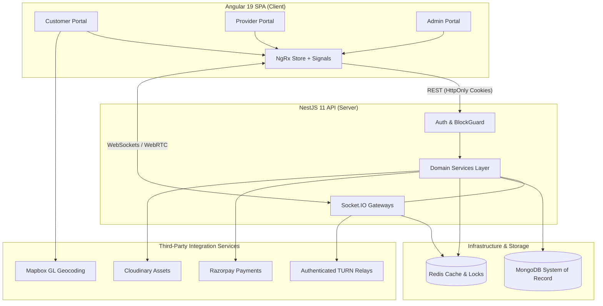

# 🏡 HomeServe — Full-Stack Home Services Marketplace

HomeServe is a production-grade, full-stack home services marketplace connecting customers with vetted local service providers under real-time administrative governance. Built using a decoupled **Polyrepo Architecture**, it enforces role-based security across three distinct Angular 19 portals (**Customer**, **Provider**, and **Admin**) powered by a modular NestJS 11 REST API and Socket.IO real-time engine.

---

## 🔐 Pre-Configured Test Roles

* 👤 **Customer Portal:** Demo Customer Account (Browse, Book, Cart, Wallet, Live Chat)
* 🛠️ **Provider Portal:** Demo Provider Account (Availability, Catalog, Analytics, KYC)
* 🛡️ **Admin Governance:** Demo Admin Account (Platform Oversight, Disputes, Approvals)

---

## 📦 Polyrepo Organization Structure

| Application | Primary Tech Stack | Repository Link | Responsibilities |
| :--- | :--- | :--- | :--- |
| **`HomeServe-Server`** | NestJS 11, Node.js 20, MongoDB, Redis, Socket.IO | [`backend/`](./backend) | Modular REST API, Redis reservation locking, JWT blacklisting, WebSockets |
| **`HomeServe-Client`** | Angular 19, NgRx 19, Signals, Tailwind CSS, WebRTC | [`frontend/`](./frontend) | Multi-portal SPA, hybrid state management, real-time chat & WebRTC video UI |


---

## 🛠️ Complete Tech Stack

| Domain | Technologies |
| :--- | :--- |
| **Frontend UI** | Angular 19, TypeScript 5.7, RxJS 7.8, NgRx 19 (Store, Effects, Entity), Angular Material 19, Tailwind CSS 3.4 |
| **Data Visualization & Spatial** | Mapbox GL (Geocoding & Discovery), Apache ECharts (Financial & Provider Dashboards) |
| **Real-Time & WebRTC** | Socket.IO Client, WebRTC Peer-to-Peer, STUN/TURN Relays |
| **Backend API Server** | Node.js 20, NestJS 11, Express, Mongoose 8, Passport, JWT |
| **Caching & In-Memory Store** | Redis (Session Storage, Lock Engine, Socket.IO Pub/Sub Adapter, Token Blacklist) |
| **Financial & Media** | Razorpay SDK (Orders & Verification), Cloudinary API, Puppeteer (PDF Invoices), ExcelJS |
| **Email Infrastructure** | Nodemailer (Development), Brevo SMTP (Production), Handlebars Email Templates |
| **Testing & Deployment** | Jest, Supertest, Karma, Jasmine, Render Blueprint, GitHub Actions CI/CD |

---

## 📐 High-Level System Architecture



---

## 🏛️ Multi-Portal Feature Deep Dive

### 👤 1. Customer Portal
- **Spatial Discovery & Geocoding:** Search providers by service category and location using Mapbox GL radius filtering, with detailed provider profiles, reviews, and gallery tabs.
- **Real-Time Booking & Checkout:** Cart price breakdown calculation, 15-minute slot reservation locking, coupon validation, and Razorpay payment authorization.
- **Live Communication Suite:** Cursor-paginated Socket.IO chat and WebRTC peer-to-peer video calling featuring a draggable/minimizable picture-in-picture window overlay.
- **Account & Financial Ledger:** Wallet refund history, saved providers, profile management, and notification feeds.

### 🛠️ 2. Provider Portal
- **Operational Availability Manager:** Weekly default availability matrix, custom date overrides, slot rules, buffer time enforcement, and overlap validation.
- **Service Catalog Management:** CRUD operations for offered services with custom unit pricing, image uploads, and profession/category mapping.
- **Subscription-Gated Analytics:** Performance, revenue, and regional trends rendered with Apache ECharts, feature-gated by active provider subscription plans.
- **Financial Ledger & Wallet:** Earnings ledger, payout status, subscription management, and invoice generation.

### 🛡️ 3. Admin Governance Portal
- **Platform Analytics & Growth:** Executive dashboards tracking platform revenue trends, user growth curves, provider performance metrics, and pending approvals.
- **Governance & Verification:** KYC document review workflows, customer/provider oversight, category/profession activation, and ratings/reviews moderation.
- **Audit & Financial Reports:** Dispute investigation workflows, penalty/fine tracking, and one-click downloadable PDF and Excel financial ledgers.

---

## ⚡ Core Engineering & Architectural Mechanics

### 1. Hybrid Frontend State Management (NgRx 19 + Angular Signals)
- **Global Session & Real-Time Data (NgRx 19):** `@ngrx/entity` adapters handle normalized collections (`users`, `chat`, `notifications`) with functional effects using `inject()`.
- **Ephemeral UI State (Angular Signals):** Shopping cart items, active slot selection, and local table filters use Angular Signals to eliminate store boilerplate.
- **Optimistic Reconciliation:** Chat messages assign a temporary `clientMessageId` for instant UI feedback, reconciling seamlessly upon server Socket.IO acknowledgment.

### 2. Distributed Concurrency & Slot Reservation Locking
- **Two-Phase Slot Guard:** Combines a compound unique MongoDB index (`providerId + date + slot`) with a **15-minute TTL reservation document**.
- **Redis Payment Lock:** Acquires an in-memory lock during Razorpay payment initiation. If verification succeeds, the booking finalizes; if payment fails, the Redis lock releases immediately and the TTL reservation clears.

### 3. Enterprise Security & Token Rotation Protocol
- **Password Security:** Password protection backed by argon2 memory-hard hashing algorithm.
- **Refresh Token Family Rotation:** Refresh tokens rotate on use. Replaying a token triggers immediate Redis-based destruction of the entire token family.
- **Access Token TTL Blacklisting:** Upon user logout, remaining JWT access token TTLs are blacklisted in Redis to block token reuse.
- **HttpOnly Cookie Transport:** Tokens are transported strictly via `HttpOnly` and `SameSite` cookies with `withCredentials` CORS security.

### 4. Real-Time Infrastructure & Secure WebRTC Signaling
- **Ephemeral TURN Credentials:** STUN/TURN credentials for WebRTC video calling are generated on-demand behind an authenticated NestJS endpoint, keeping relay secrets out of client bundle code.
- **Redis Socket Pub/Sub Adapter:** Socket.IO gateways utilize a Redis pub/sub broker to maintain seamless room presence across horizontally scaled NestJS node instances.

---

## 🛠️ Real-World Problems Solved

| Problem Identified | Root Cause / Risk | Technical Resolution | System Impact |
| :--- | :--- | :--- | :--- |
| **Refresh-Token Reuse & Silent Races** | Replayed or stolen refresh tokens allowed unauthorized access; concurrent refreshes failed. | Redis session families with rotated-JTI tracking, atomic Lua scripts, and short grace windows. | Replayed tokens trigger instant session family destruction; zero silent-refresh user drops. |
| **Double-Booking & Payment Races** | Simultaneous checkouts allowed two customers to reserve the same slot. | Two-phase locking using 15-min TTL MongoDB reservations and Redis checkout locks. | Guaranteed zero double-bookings during peak checkout traffic; auto-clears on failure. |
| **Exposed WebRTC Relay Secrets** | Static TURN credentials in client bundle exposed relay infrastructure. | Ephemeral TURN token generation behind an authenticated NestJS endpoint. | Zero credential leaks in client JavaScript bundles; secure WebRTC video calls. |
| **Stale UI Filter Results** | Rapid search bar typing triggered out-of-order HTTP response overwrites. | Refactored search and filter streams to use the RxJS `switchMap` operator. | In-flight stale requests are cancelled; UI strictly reflects latest user keystrokes. |
| **Analytical Reporting Discrepancies** | Multi-service bookings double-counted revenue in aggregation pipelines. | Deduplicated booking IDs prior to executing MongoDB aggregation math. | 100% accurate financial, GST, and provider earnings trend reports. |

---

## 💾 Database Indexing & Redis Architecture

### MongoDB Indexing Strategy
* **GeoJSON `2dsphere` Index (`Provider.location`):** Powers spatial radius discovery via `` aggregation pipelines.
* **Compound Unique Index (`ProviderSlot`):** Database-level enforcement of `providerId + date + slot` uniqueness.
* **TTL Auto-Expiry Index (`Reservation.createdAt`):** Automatically purges abandoned 15-minute checkout reservations.
* **Cursor Indexes (`Chat.messageId`, `Notification.id`):** Enables efficient pagination over chat history without offset performance penalties.

### Redis Cache & Storage Map
```text
┌─────────────────────────────────────────────────────────────────────────────┐
│                            Redis In-Memory Store                            │
├──────────────────┬──────────────────┬───────────────────┬───────────────────┤
│ Auth & Sessions  │ Concurrency Lock │ Real-Time Gateway │ Cache & Presence  │
├──────────────────┼──────────────────┼───────────────────┼───────────────────┤
│ • OTP Storage    │ • Slot Checkout  │ • Socket Pub/Sub  │ • HTTP Cache      │
│ • Token Blacklist│   Payment Locks  │   Adapter         │ • User Online Map │
│ • Token Families │ • Rate Limiting  │ • STUN/TURN Cache │ • Call State      │
└──────────────────┴──────────────────┴───────────────────┴───────────────────┘
```

---

## 💻 Local Development Setup

### Prerequisites
* **Node.js:** v20.x or higher
* **Package Managers:** `pnpm` (recommended for backend), `npm`
* **Databases:** Local or remote MongoDB 8+ and Redis instance

### 1. Backend Server Setup
```bash
# Navigate to backend directory
cd backend

# Install dependencies
pnpm install

# Configure environment variables
cp .env.development .env

# Start NestJS dev server (Listens on http://localhost:5000/api)
pnpm run start:dev
```

### 2. Seed Administrator Account
```bash
# Seed initial admin user
pnpm run seed:admin
```

### 3. Frontend SPA Setup
```bash
# Navigate to frontend directory
cd frontend

# Install dependencies
npm install

# Start Angular dev server (Runs on http://localhost:4200)
npm start
```

---

## 🚧 Known Limitations & Technical Roadmap

* 🧪 **Automated Test Coverage:** Core domain services feature unit tests; implementing a full Playwright E2E suite and GitHub Actions CI workflow is planned.
* 📦 **Shared DTO Package:** Extracting duplicated TypeScript API models into an npm/pnpm workspace package for unified type safety across network boundaries.
* 🐳 **Containerization:** Deployed via Render blueprints. Adding a multi-container `docker-compose.yml` file for single-command developer onboarding.

---

## 📄 Author & License

**Author:** Muhammed Sajid S  
**Specialization:** Full-Stack / MEAN Stack Engineer (Angular, NestJS, TypeScript, Node.js, PostgreSQL, MongoDB, Redis, AWS)  
**License:** MIT License
